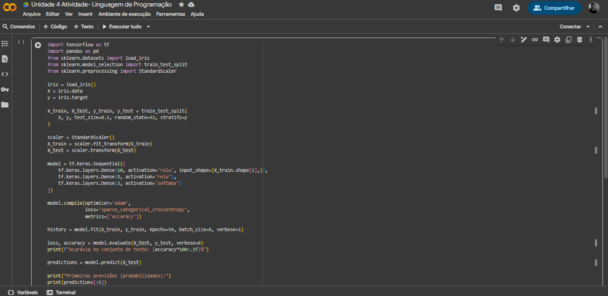
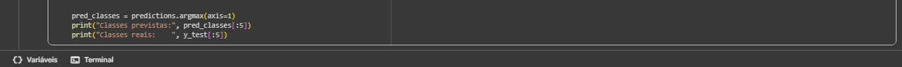
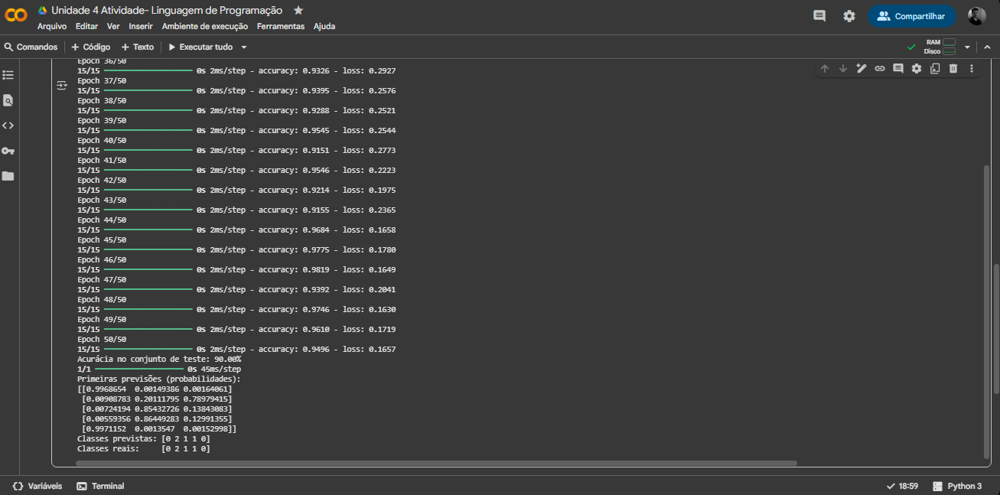

# ATIVIDADE PRÁTICA - Machine Learning Com Python  

---

*A recomendação da minha instituição foi utilizar o Google Colab para desenvolver o código e executá-lo.*

---

## A ORIENTAÇÃO DO PROJETO FOI A SEGUINTE:

Você foi contratado para criar um modelo de Machine Learning que classifica espécies de flores Iris
com base em características como comprimento e largura das sépalas e pétalas. Você usará o
TensorFlow para construir, treinar e avaliar o modelo

###  Passo 1: Importar Bibliotecas e Carregar Dados
- Usar bibliotecas como tensorflow, pandas e scikit-learn.
- Carregar o conjunto de dados Iris disponível no scikit-learn.

### Passo 2: Pré-processamento dos Dados
- Dividir o conjunto de dados em treinamento e teste.
- Normalizar os dados.

###  Passo 3: Construir o Modelo
- Usar TensorFlow para construir um modelo de rede neural simples.

###  Passo 4: Treinar o Modelo
- Treinar o modelo com os dados de treinamento

### Passo 5: Avaliar o Modelo
- Avaliar a precisão do modelo usando os dados de teste.

### Passo 6: Fazer Previsões
- Fazer previsões com o modelo treinado

---

## Vamos começar mostrando meu código por completo!

Você pode acompanhar pela imagem abaixo ou pelo arquivo aqui no github ---> [Arquivo do Projeto](https://github.com/lukkyzdev/MachineLearningComPython/blob/main/MachineLearningComPython.py)

---

## Testes e Execução

---

## Conclusão e Explicações

- *O código começa importando as bibliotecas necessárias e carregando o
conjunto de dados Iris, que contém medidas das sépalas e pétalas de três
espécies de flores. Em seguida, os dados são divididos em treino e teste
e passam por normalização para ficarem na mesma escala.*

*Depois disso, é construída uma rede neural simples com o TensorFlow:
duas camadas escondidas (com 10 e 8 neurônios, usando ativação relu)
e uma camada de saída com 3 neurônios (usando softmax, já que temos
3 classes).*

*O modelo é compilado com o otimizador adam, a função de
perda **sparse_categorical_crossentropy** e a métrica de acurácia.*

*O treinamento acontece em 50 épocas, ajustando os pesos da rede para
aprender os padrões. Em seguida, o modelo é avaliado no conjunto de
teste para medir a precisão alcançada.*

*Por fim, o modelo faz previsões: gera probabilidades para cada espécie
de flor e indica qual classe tem maior chance, permitindo comparar com
as classes reais.*
